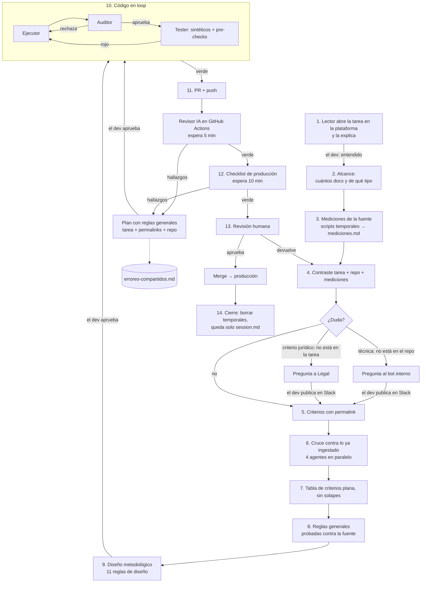
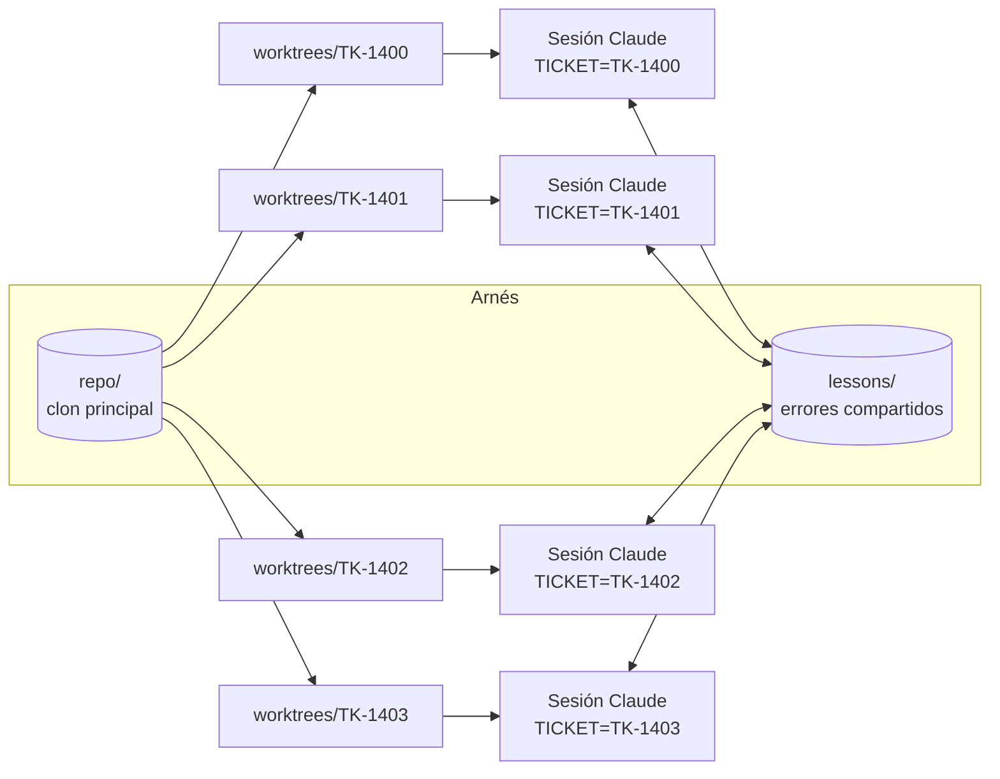

# Arnés multiagente para tickets de scrapers

Arnés sobre **Claude Code** para llevar **varios tickets de scrapers en paralelo** (4 en mi caso) desde la lectura de la tarea hasta producción: un git worktree, una sesión de agentes y una carpeta de estado por ticket.

Lo construí y usé en un equipo de ingesta de documentos legales. Este repo es una reconstrucción genérica: los nombres de herramientas internas se reemplazaron por equivalentes (`la plataforma` = tracker de tickets + base de documentos ingestados, `bot interno` = asistente técnico de la empresa, `revisor IA` = revisión automática del PR en GitHub Actions, `checklist de producción` = validación previa a revisión humana).

**Por qué existe:** había una meta mensual de tickets y un ticket solo contaba como terminado cuando **estaba desplegado en producción**. Con esperas largas en cada ticket (revisiones automáticas, respuestas de Legal, revisión humana), la única forma de sostener el ritmo era trabajar varios a la vez sin que se pisaran.

## Ideas centrales

| Problema | Cómo lo resuelve el arnés |
|----------|---------------------------|
| El agente "recuerda" mal y alucina | **Prohibido responder de memoria.** Solo 3 fuentes: la tarea (la plataforma), el repo y los permalinks de las consultas a el bot interno o a Legal. |
| Se pierde el estado al compactar el contexto | `session.md` por ticket + hook `SessionStart` que lo reinyecta en startup/resume/compact. |
| Tickets paralelos se pisan | Un **git worktree** + una rama + una sesión + una carpeta de estado por ticket. Un hook bloquea escribir en el ticket de otra sesión. |
| Temporales que ensucian el repo | Mediciones, scripts y tests sintéticos viven en `tickets/TK-XXXX/`, fuera del código base. |
| Parches que pasan la revisión pero rompen después | Cada criterio → **regla general probada contra la fuente** antes de escribir código. |
| Errores que se repiten entre tickets | `lessons/errores-compartidos.md`: lo leen todos los tickets y alimenta los tests de regresión. |
| Gasto de tokens | Modelo por complejidad: haiku (mecánico), sonnet (por defecto), opus (lógica difícil y planes). |

## Estructura

```
agent-harness/            arnés (cwd de cada sesión)
├── CLAUDE.md                    reglas duras + tabla de fases
├── harness.config.sh            repo, tiempos de espera, comandos de test
├── .claude/
│   ├── settings.json            hooks
│   ├── agents/                  lector-tarea · medidor · cruce-ingestas · ejecutor · auditor · tester · revisor-hallazgos
│   └── skills/                  fases-ticket (orquestador) · preguntar-bot-legal · cruce-ingestas
│                                tabla-criterios · reglas-generales · diseno-scraper · matriz-tests
│                                loop-hallazgos · cerrar-ticket
├── hooks/                       session-start · user-prompt · guard · post-push
├── scripts/                     new-ticket · parallel · run-tests · wait-review · prod-checklist · close-ticket
├── templates/                   session · mediciones · preguntas · criterios · reglas · plan-hallazgos
├── lessons/errores-compartidos.md
├── repo/                        clon del código base (gitignored)
├── worktrees/TK-XXXX/          un worktree por ticket (gitignored)
└── tickets/TK-XXXX/            estado del ticket (gitignored; al cerrar queda solo session.md)
```

## Flujo de un ticket



## Paralelismo: 4 tickets a la vez



Mientras un ticket espera al revisor IA (5 min), al checklist de producción (10 min), una respuesta de Legal o una revisión humana, los otros avanzan. Mi rol era el de las **puertas humanas**: confirmar que entendí la tarea, publicar preguntas, aprobar el diseño, aprobar cada plan de hallazgos y hacer el merge.

## Uso

Requisitos: Claude Code, git ≥ 2.20, GitHub CLI (`gh`) autenticado, node, bash (Linux/macOS/WSL o Git Bash), tmux opcional.

```bash
# 1. Configura el repo y los comandos de test
$EDITOR harness.config.sh

# 2. Un ticket
scripts/new-ticket.sh TK-1400
TICKET=TK-1400 claude --add-dir worktrees/TK-1400
#   > usa fases-ticket

# 3. Cuatro tickets en paralelo (una ventana de tmux por ticket)
scripts/parallel.sh TK-1400 TK-1401 TK-1402 TK-1403

# 4. Loop de revisión (lo lanza el agente; también se puede a mano)
TICKET=TK-1400 scripts/wait-review.sh
TICKET=TK-1400 scripts/prod-checklist.sh

# 5. Cierre, cuando está en producción
scripts/close-ticket.sh TK-1400
```

## Hooks

| Hook | Evento | Para qué |
|------|--------|----------|
| `session-start.sh` | SessionStart (startup, resume, compact, clear) | Reinyecta ticket, worktree, `session.md` y los últimos errores compartidos. El estado sobrevive a la compactación. |
| `user-prompt.sh` | UserPromptSubmit | Una línea antes de cada mensaje: ticket, fase actual y la regla de las tres fuentes. |
| `guard.sh` | PreToolUse (Bash, Write, Edit) | Bloquea push a main, force push, borrar `repo/` o `worktrees/`, archivos del arnés dentro del worktree y escribir en el ticket de otra sesión. |
| `post-push.sh` | PostToolUse (Bash) | Registra cada push (commit y mensaje) en `session.md` y recuerda lanzar el loop del revisor IA. |

## Ejemplo

`tickets/_ejemplo-cerrado/session.md` muestra cómo queda un ticket cerrado (datos ficticios): alcance con fuentes, decisiones con permalink, loop ejecutor/auditor/tester, historial de pushes y la guía para depurar.
